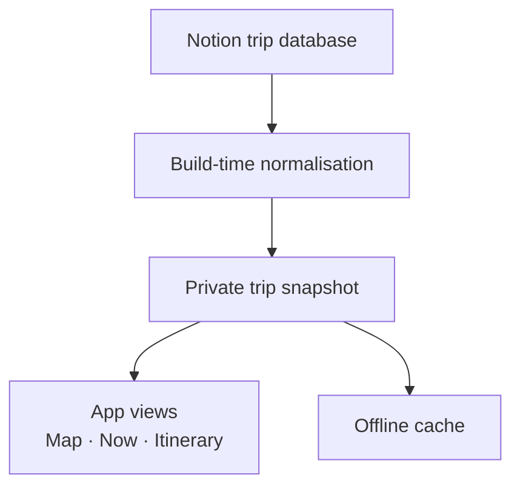

Flights were in email. Hotels were in booking apps. The rental car had its own confirmation, door codes arrived in messages, and the itinerary itself lived in Notion.

None of those tools was particularly bad at its job. The problem was that on the road I did not want five good tools. I wanted one screen that could answer three fairly boring questions: **where are we in the trip, what is next, and what do I need when I get there?**

I did not want another trip planner. Notion was already where I wanted to plan the trip. I wanted a read-only companion for the bit after the planning: the thing I could open from the passenger seat, outside an airport or in front of a locked apartment door.

So I built a small private PWA around the trip. There is a public version with completely invented data at [trip-demo.kud.io](https://trip-demo.kud.io/).


## Notion stays the editor

The app deliberately has no trip editor.

The real trip is a Notion database. A row can be a flight, a drive, a hotel, a meal, a visit, a swim, a car rental or one of the other things that make up a journey. It carries the time, place, travellers and, when relevant, the practical information attached to it: booking reference, address, phone number, check-in window, access code or reservation link.

At build time those rows are normalised into one trip. Roads are resolved onto road geometry, flights become great-circle arcs, places get coordinates and time zones, and the result is written as a private snapshot that the app can serve after authentication.



That split is useful in both directions. Notion stays good at editing a plan. The app can be aggressively optimised for using one.

It also means opening the app does not turn into a chain of live Notion requests. The trip has already been shaped into what the interface needs.

## The map is a clock, not a tracker

The map looks a little like a live map, but it is not GPS tracking.

If a drive is planned from 10:00 to 11:00, the illustrated vehicle is halfway down that route at 10:30. During a flight, the plane moves along the flight arc. Pick another step and the map can play that leg instead.

The distinction matters: **the map shows the trip's planned state, not a claim about where somebody physically is.**

I can move through the itinerary and see the trip at that moment without needing a location history. If I open a particular day, the map frames that day's stops and roads and numbers its stops in the order we reach them. The rest of the trip fades back but stays tappable.

The map follows time in a few other ways too. Day and night come from the actual position of the sun at the place being shown, not from the phone's dark-mode setting. By default the interface follows the sun as well, through golden hour and blue hour into night; the settings can still pin it to light, dark or the phone's own choice. The current weather can sit over the map. The vehicle changes with the leg: car, taxi, bus, train, boat, plane or walking.

The animation is excessive for a travel utility, on purpose. Tiny vehicles and stop miniatures make the thing feel like a trip rather than fleet-management software.

## The sheet is the product

The map is the overview. The sheet underneath it is where the app earns its place.

It has two modes.

**Now** reduces the trip to what is useful at the current moment. Before a flight it can tell me when I should be at the airport. During a drive it shows what is left. At a hotel it can surface tonight's access information instead of making me dig through the whole itinerary.

**Itinerary** is the trip as a continuous timeline. Days have sticky headers with their date, their position in the trip, where the day leads, the road distance and the weather. The overnight label changes as the day moves from where we woke up to where we are sleeping.

The timeline is still one list, but it is easy to move through it. Day arrows jump to the previous or next day. Search and filters work across the whole trip. A calendar view compresses the trip into one card per day: date, towns, kilometres and weather. Pick a day there and the app jumps to it while the map frames the same day.


That coupling between list and map became important. The itinerary is not just an agenda beside a map; it is another way of moving the map through time.

When I browse away from the live moment, a floating button takes me back to now. Individual steps can also be slid open for their immediate actions rather than carrying permanent buttons on every row. The interface stays fairly quiet until I actually need something.

The first version had much less of this. Using the app during the trip made it obvious that a long itinerary is not one long list of equal events. Some things deserve permanent precision. Others should barely be scheduled at all.

## A trip has facts, windows and suggestions

Flights worked well from the start because flights are easy to model. They leave at a time. A rental car has a return deadline. A hotel has a booking and a check-out. If the interface is wrong about one of those, the day can go badly.

Sightseeing is different.

In the first version, a visit could look too much like a flight: start time, end time, next row. Put enough visits into a day and the app quietly turns a holiday into a calendar you can be late for.

That was the wrong model, so the data changed.

A step can now be **fixed**, a **window**, or **flexible**. A flight is fixed. A check-in can be a window. Walking around a town can simply be "afternoon". A separate deadline handles the cases where the plan is loose but one edge is not: return the car before 17:30, leave the room before 11:00.

That distinction is small in the database and large in the interface. The app no longer has to invent false precision just because every row technically has a time.

Stopovers got their own version of the same idea. "Spend the afternoon in town" can be one flexible step with a few ideas folded underneath it: the old centre, a viewpoint, somewhere to eat. Those are **and/or** possibilities. They do not become three appointments and they do not move the rest of the day if one takes longer.


Plan B is different. Two restaurants that substitute for each other are **either/or**. A Plan B can have its own notes, contact details, weather and directions, and can be opened on the map, but it remains an alternative to the original step.

They look similar in a database. They represent different decisions when you are actually travelling.

That became the main product rule: **be strict about the constraints that can ruin the day, and loose about the parts that make the day enjoyable.**

## Put the useful detail next to the thing that needs it

Opening a step shows the practical information beside the step rather than in a separate bookings screen.


A hotel can expose its booking number, address, phone number, check-in, check-out and access instructions. A car rental can put the desk's number and return deadline next to the route there. A flight can carry its reference, travellers and seats, with a tiny seat map showing where those seats are in the row.

The seat map is comically specific. It was also useful.


The same principle applies to people. A step can belong to one traveller, several, or everyone. The viewer can switch who they are looking at, so the app can represent one shared trip without pretending everybody has exactly the same journey.


A step can also be shared. The share text includes what, when and where, plus a link that opens the same step in the app. It deliberately leaves out the booking card: no access code, reservation number or phone number gets copied into the message by accident. The link still goes through the app's gate for somebody who is not signed in.

## Offline and private were requirements

A travel companion is unusually bad if it works everywhere except where you are travelling.

The PWA caches its shell and, after authentication, the trip data. Map tiles are cached as they are seen, and the area around the trip can be fetched ahead of time into a separate pinned cache so ordinary cache trimming does not throw it away.


For pages and trip data, the app gives the network four seconds. If the connection is merely terrible and a cached copy exists, it uses that copy instead of leaving the screen hanging. The network request can still finish afterwards and refresh the cache for next time.

Privacy pulls in the other direction. The real trip contains addresses, reservation references and sometimes door codes. None of that belongs in a public JavaScript bundle or an unauthenticated cache.

The trip snapshot is served only behind a signed session. The gate can use an access code, Sign in with Notion, or both. Authentication pages and redirects are never cached. Logging out clears the cached private trip.

The public demo uses the same application with invented travellers, places and bookings. It can therefore show the real interaction model without publishing the holiday.

## A few boring engineering choices paid off

Most of the time logic lives outside the React components as pure functions: given a trip and an instant, work out the selected step, current leg, tonight's stay, next action or day that should be visible.

That matters because travel time is full of irritating boundary cases. Midnight. The morning after a hotel stay. A flight that leaves in one time zone and lands in another. A hotel whose "end" means waking up, followed by breakfast before actually leaving. Browsing tomorrow while the app still needs to know where the travellers are now.

Time zones therefore belong to the trip data, not to whatever zone the phone happens to be in.

There is also a debugging feature I would add again immediately:

```text
https://trip-demo.kud.io/?t=2030-06-01T15:00
```

`t=` pins "now" to a moment in the trip. Temporal UI is otherwise tedious to test. Midnight, a flight in progress, the morning after a stay and the last step of the trip become URLs rather than appointments with the clock.

Steps keep the identity of their source row too. Renaming or moving one in Notion does not silently create a new identity, which matters once direct links can open a step.

The build-time model also needed an escape hatch for edits. From the app I can ask for the trip to be refreshed. That triggers a rebuild from Notion; the running app polls until the newer snapshot exists, fetches a fresh page into the offline cache, then reloads. The data stays build-time without making a correction on the road feel like a deployment ceremony.

## It was built for one trip

It started as a thin interface over a Notion itinerary. By the end, most of the interesting code was not really about maps or bookings. It was about time: what is happening, what can move, what must not be missed, and what the interface should stop pretending to know.


Some of this is more engineering than a week-long road trip strictly requires. Using it made the useful boundary clearer.

I do not need travel software to decide what I should see in a town or to turn every afternoon into an appointment. I do want it to remember the hotel code, know which flight belongs to whom, keep the map around when the signal disappears and make it difficult to miss the one thing today that really has a deadline.

The public demo uses invented data but otherwise follows the same model: [trip-demo.kud.io](https://trip-demo.kud.io/).