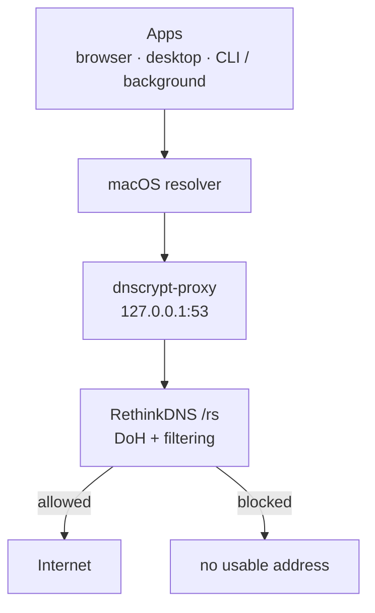

On my phone I had already got used to [Rethink DNS + Firewall](https://rethinkdns.com/app). I liked the idea that blocking ads, trackers and known malicious domains did not stop at the browser: the policy applied to the whole device.

On macOS, most of my blocking still lived in the browser. That covers the web well, but it says nothing about desktop apps, Electron apps, games or background processes resolving their own domains.

I wanted the same kind of broad DNS layer on the Mac, underneath the browser blocker rather than instead of it.

The setup I settled on is a local `dnscrypt-proxy` forwarding encrypted DNS to a filtering RethinkDNS endpoint. The browser blocker stays where it is for the precise, page-aware work; DNS catches a coarser class of traffic before the rest of the machine gets an address for it.

The pieces fit together like this:



The useful bit is not that DNS is a particularly clever ad blocker. It is that it sits somewhere browser extensions cannot.

## 1. Install dnscrypt-proxy

Homebrew has a package for it:

```bash
brew install dnscrypt-proxy
```

Its configuration lives at:

```bash
$(brew --prefix)/etc/dnscrypt-proxy.toml
```

I want the proxy listening locally on the normal DNS port:

```toml
listen_addresses = ['127.0.0.1:53']
```

Because the proxy listens on `127.0.0.1:53`, I start it as a system service with `sudo`. That also installs it as a launch daemon, so it starts at boot rather than only inside my login session:

```bash
sudo brew services start dnscrypt-proxy
```

At this point there is a DNS server on the Mac. That does **not** mean the Mac is using it yet. Before wiring macOS into it, I also need to make sure the upstream resolver actually filters.

## 2. Choose a resolver that actually filters

`dnscrypt-proxy` gives me encrypted DNS transport and can also do local filtering, but those are separate choices. If I point it at an upstream resolver that does no filtering and configure no local blocklists, I get private transport and exactly the same DNS answers as before.

RethinkDNS makes the distinction visible in its endpoints:

| Endpoint | Transport | Policy |
| --- | --- | --- |
| `https://sky.rethinkdns.com/dns-query` | DoH | No filtering |
| `https://sky.rethinkdns.com/rs` | DoH | Default malware and ad blocking |

The [Rethink app](https://github.com/celzero/rethink-app) currently uses `/rs` as its default malware and ad-blocking resolver. Its [configuration page](https://rethinkdns.com/configure) can generate a different endpoint if I want to choose the blocklists myself.

There is an easy trap here. The public resolver list bundled with dnscrypt-proxy includes RethinkDNS as `rethinkdns-doh`, but that resolver is explicitly marked `NoFilter|NoLog`. Selecting it gives me encrypted DNS, not an ad blocker.

For the filtering `/rs` endpoint, I define a static server instead. The default config already contains `server_names` and `listen_addresses` (TOML refuses a key defined twice), so I edit those lines in place and add the `[static]` entry:

```toml
server_names = ['rethinkdns-rs']
listen_addresses = ['127.0.0.1:53']

[static]
  [static.'rethinkdns-rs']
  stamp = 'sdns://AgIAAAAAAAAAAAASc2t5LnJldGhpbmtkbnMuY29tAy9ycw'
```

The stamp is just dnscrypt-proxy's compact description of a DoH server. This one points at `sky.rethinkdns.com/rs`.

If I build a custom RethinkDNS endpoint instead, I can turn its URL into an `sdns://` stamp with the [DNS stamp calculator](https://dnscrypt.info/stamps/).

After changing the config:

```bash
sudo brew services restart dnscrypt-proxy
```

I prefer starting with Rethink's preset. Choosing blocklists can become a hobby very quickly, and I wanted a useful coarse filter underneath the browser, not a second job comparing lists that mostly block the same analytics hosts.

## 3. Point macOS at the local proxy

This is the step that turns the local daemon into a system-wide DNS layer.

A running daemon on `127.0.0.1:53` is only useful if macOS sends DNS queries to it. For Wi-Fi:

```bash
sudo networksetup -setdnsservers "Wi-Fi" 127.0.0.1
```

If I also use Ethernet, a dock or another network service, `networksetup -listallnetworkservices` shows the names I need to configure separately.

The quick check is:

```bash
networksetup -getdnsservers "Wi-Fi"
```

That should return:

```text
127.0.0.1
```

For the fuller picture:

```bash
scutil --dns
```

macOS maintains several scoped resolvers, so the output is noisy, but the active resolver for the network service should now point at `127.0.0.1`.

Starting a DNS proxy and routing the machine through a DNS proxy are different operations. A green service status only proves the first one.

## 4. Check both halves

There are two things worth testing independently: the local proxy, and macOS's route to it.

First, ask the proxy itself:

```bash
dig +short @127.0.0.1 example.com
dig +short @127.0.0.1 doubleclick.net
```

The ordinary domain should return an address. A domain blocked by the chosen RethinkDNS policy should not return a normal usable one. Blocklists change, so the exact test domain is less important than checking one that the policy currently blocks.

Then ask through macOS's native resolver. `dig` is not a good witness for this half: on macOS it does not use the same name-resolution and DNS-routing mechanisms as ordinary applications. `dscacheutil` performs the lookup through the system's standard calls:

```bash
dscacheutil -q host -a name example.com
dscacheutil -q host -a name doubleclick.net
```

If macOS is really using the local proxy, the blocked domain should come back without a usable address here too.

After changing DNS policy I also flush the macOS cache:

```bash
sudo dscacheutil -flushcache
sudo killall -HUP mDNSResponder
```

Otherwise an application may keep using an answer obtained before the switch.

This is a better test than checking whether `dnscrypt-proxy` is running, because a healthy daemon does not prove that macOS is actually sending queries through it.

## What DNS filtering actually buys

A browser blocker has much richer information than DNS. It sees requests in the context of a page, can distinguish some first-party and third-party content, hide elements after blocking them, inspect URL paths and apply cosmetic rules.

DNS sees a hostname.

That is a severe limitation, and also why the same rule can cover Safari, an Electron app, a game and a background process.

| Traffic | DNS filter | Browser blocker |
| --- | --- | --- |
| Known third-party ad or tracker domain | Good fit | Good fit |
| Tracker called by a desktop app | Good fit | Never sees it |
| Known phishing or malware domain | Useful first barrier | Depends on the browser |
| Ad and wanted content on the same hostname | Cannot separate them | Sometimes can |
| Empty ad container left in a page | Cannot hide it | Can |

If `analytics.vendor.example` is blocked, an application using this resolver never gets a usable address for it. DNS does not inspect the HTTP request that would have followed. It cannot strip tracking parameters, rewrite a payload or decide that one path on a hostname is acceptable and another is not.

It is not an antivirus either. A new malicious domain can miss the lists, a compromised legitimate domain still has a legitimate hostname, and an application can bypass the whole thing by using its own resolver or connecting directly to an IP address.

So I keep the browser blocker. It does the precise, page-aware work. DNS catches a broader and much coarser class of traffic before those applications get as far as making the connection.

## Keep an escape hatch

System-wide filtering is pleasant right up until a captive portal decides it has opinions about DNS.

Hotel, airport and train Wi-Fi can expect the resolver supplied by the network while they redirect me to a login page. Debugging is also easier if I can remove my DNS layer in one command.

Back to the network defaults:

```bash
sudo networksetup -setdnsservers "Wi-Fi" empty
```

Back to the local proxy:

```bash
sudo networksetup -setdnsservers "Wi-Fi" 127.0.0.1
```

I like this more than a setup that is technically harder to bypass. When something breaks, I want to remove one layer, learn something, and put it back.

## The traffic that can still go around it

Pointing macOS at `127.0.0.1` gives broad coverage, not control over every DNS query the machine can possibly make.

- **Browser secure DNS.** A browser can send DoH itself instead of using the system resolver. If I want one DNS policy, I disable that or point it at the same filtered service.

- **VPNs.** Many VPNs install their own DNS configuration while connected.

- **iCloud Private Relay.** Apple says Private Relay encrypts DNS name-resolution requests as part of its own privacy path, so I do not assume those queries are passing through my local resolver. [Apple documents the interaction with VPN and filtering software separately](https://support.apple.com/en-gb/102022).

- **Applications with their own resolver or a hard-coded IP.** DNS cannot filter a lookup it never receives.

Those are not bugs in dnscrypt-proxy. They are the boundary of a system-resolver approach.

## Why keep a local proxy at all?

macOS can also use an encrypted DNS server through Apple's [DNS Settings configuration](https://support.apple.com/en-gb/guide/deployment/dep86469ba99/web). If all I wanted was "send DNS over HTTPS to this resolver", that is the lighter architecture: no local daemon, no listener on port 53.

I still like the proxy because there is something useful at the boundary. It caches DNS locally. I can enable query logging when an application is doing something odd. I can change the upstream without changing every client, and dnscrypt-proxy itself has local filtering and routing features if I ever want them.

Mostly, I can inspect it.

The browser blocker remains where it was. The DNS layer does not replace it and does not try to become a worse version of it. It just catches hostname-level junk in places where the browser extension never gets a vote.

And the setup is easy to reason about now: `127.0.0.1` tells me where DNS enters, `/rs` tells me which upstream policy I chose, and `networksetup ... empty` gets me out when a hotel Wi-Fi decides to be clever.