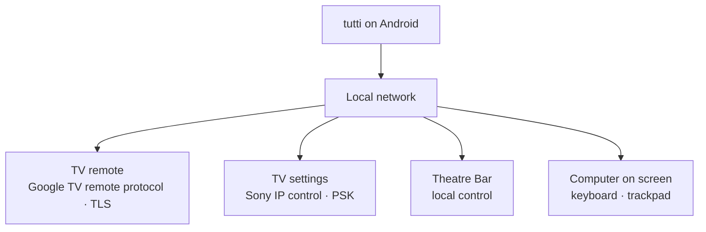

I've always liked the idea of having everything in one place. My living room has a Sony BRAVIA TV, a Theatre Bar, and often a laptop connected to the screen. Each comes with its own way of controlling things.

There are already good apps for controlling these devices. Google TV is useful for everyday TV navigation, while BRAVIA Connect comes closest to bringing my Sony setup together, including the soundbar. I still use it, particularly for device-specific features. But I wanted to explore a different approach: keeping the controls I use most in one place, with more freedom to customise the layout and shortcuts. This isn't about replacing every feature of the official apps; it's about shaping the everyday experience around how I use my living room.

I wanted something different: one thoughtfully designed remote on my phone, where the TV and soundbar feel like parts of the same living room rather than separate destinations. The everyday controls should be close at hand, with a dock I can make my own.

But I didn't want simplicity to mean giving up control. I wanted room for shortcuts, scenes and more advanced settings when I felt like exploring them, without making the main screen complicated.

That's why I started building [tutti](https://tutti.beansontoast.app/).

## Simple on the surface, flexible underneath

The main screen is deliberately straightforward: a touchpad that can switch to a D-pad, volume beside it, and a dock for favourite apps and keys. It should feel like a remote, not a settings panel. When I need to type into a TV text field, the phone keyboard is right there instead of another tedious trip around an on-screen keyboard.

But the dock is editable, and that's important. Different people use different apps and commands. I want the controls I reach for to reflect my own living room, rather than somebody else's idea of a universal remote.

Theatre Bar controls, including input, effects and DRC.

Typing on the phone instead of navigating an on-screen keyboard.

I also wanted to control the laptop when its screen is on the TV. tutti can act as its keyboard and trackpad from the sofa.

Sony's own apps still have a place. I use BRAVIA Connect for occasional jobs such as room calibration, speaker placement and firmware updates. I don't need to reproduce those screens. The soundbar controls I use regularly belong beside the TV controls.

Scenes take that idea further. I can group an input or app, a picture mode and a volume cap into one action, even though they live in different corners of the devices' menus. It's a small example of the balance I'm after: one easy action on the surface, with more control underneath.

I'd like to push that further over time, with more freedom to customise keys and reach advanced TV functions without crowding the everyday remote. That's the direction, not a claim that every possible command is already supported.

## Direct control, without the clutter

The remote works over the local network. It doesn't need my server or a Sony account to send the usual commands.

The Google TV remote protocol handles keys, the pad, keyboard and voice. Pairing begins with the six-character code shown on the TV; subsequent traffic uses TLS.

For inputs, picture mode and sound output, tutti uses Sony's IP control API and a pre-shared key configured on the TV. The Theatre Bar has a separate local control port, available when External control is enabled.

tutti pins each device's certificate on first contact. A changed certificate at the same address is refused rather than accepted silently. Pairing material is encrypted with Android Keystore and excluded from backups.

There are a few online features: GitHub update checks, artwork loaded from image hosts, and optional Sony sign-in. None is required to press Volume Down.

## A remote should feel reliable

Phones sleep, Wi-Fi drops briefly, and TVs take time to wake. During those gaps the app may be open, but its connection isn't.

A good interface is also honest about what it can do. If the connection drops, tutti dims the controls and a failed press reports **Not sent**. It doesn't quietly queue a volume or navigation command to execute later, when I might no longer want it. That may sound like a small detail, but it matters every time I pick up the phone.

Connection status is also described consistently across the remote, setup and Settings. The text matters: colour alone shouldn't be the only way to tell whether a device is connected.

## Picking up where I left off

A remote is something I open for a few seconds, put away, and open again. It shouldn't make that feel like starting a new session. In 0.3.0, tutti keeps the TV connection alive briefly after I leave the app. When it does need to reconnect, it shows **Connecting…** and dims the controls until they're ready. The now-playing card keeps its last known content rather than flashing an empty state.

Android may still suspend the app in the background, so an occasional reconnect is unavoidable. The aim is not to hide that reality, but to make the transition calm and understandable.

## The details that make it yours

Search is available from playback controls, either within the current TV app or across the TV. Lock-screen artwork is sharper. Settings now groups TV, soundbar, sync and features into four tiles, and the dock supports long-press editing with more UK and European app icons.

The GitHub build lets me choose final releases or test builds. After an update, a quiet notification provides a way back to the remote. There are also fixes for keys disappearing after the phone sleeps and for a crash when opening playback controls over Nuvio.

Sync stores the layout, scenes and settings in one file in a folder I choose, using Drive or another storage provider. A second phone can use the same configuration without creating a tutti account.

The [0.3.0 release notes](https://github.com/kud/tutti/releases/tag/v0.3.0) have the full change list.

## Sony first

I've tested tutti with my BRAVIA 8 and Theatre Bar 9. Other Sony models haven't been tested, and older BRAVIAs without Google TV aren't supported.

The remote protocol itself isn't limited to Sony. That leaves room for broader Google TV support later, with Sony-specific settings available where the hardware allows them. For now, I don't want to claim compatibility I haven't tested.

## What's next for tutti?

tutti started with my own living room, but I'd love for it to grow beyond my particular setup.

The first direction is broader compatibility. Today, the experience is built around Sony devices, but I'd like to explore support for more Google TV devices and, eventually, other equipment around the living room.

The second is deeper personalisation. I want everyone to be able to shape their own remote: choose their favourite buttons, arrange controls around their habits, and access more advanced features without making the everyday interface complicated.

There's also room to make the experience richer, with better artwork, more useful information about what's playing, and thoughtful ways to bring everything together.

I don't want tutti to become an overwhelming dashboard full of settings. Quite the opposite. The more capable it becomes, the more important it is that the interface stays calm, intuitive and enjoyable.

Ultimately, I'd love tutti to become a genuinely universal remote that still feels personal. Something simple enough to use without thinking, but flexible enough to make it your own.

## Links

- [tutti](https://tutti.beansontoast.app/)

- [Download and release notes](https://github.com/kud/tutti/releases)

- [Source code](https://github.com/kud/tutti)